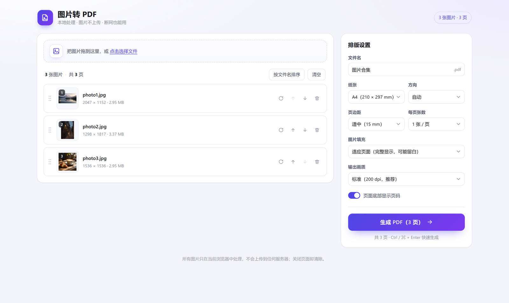
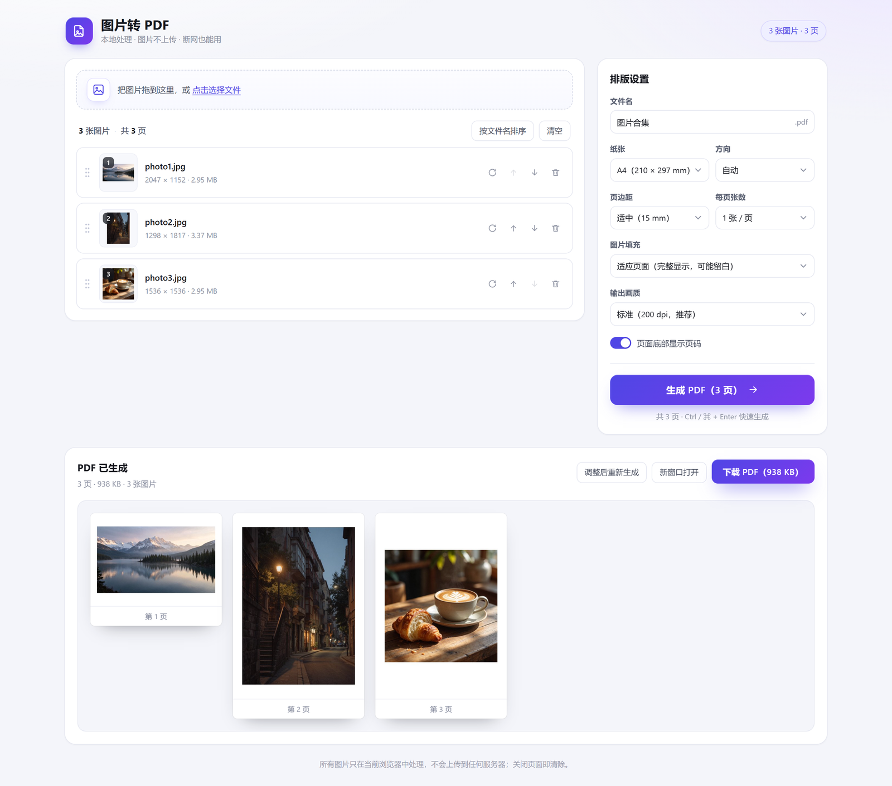

# Image to PDF

A privacy-first image-to-PDF tool that runs **entirely in your browser**. No uploads, no backend, no third-party frontend dependencies — it works offline, and you can run it by opening `index.html`.

[Live demo](https://pppyx-hub.github.io/image-to-pdf/) · [中文说明](README.md)

[](https://github.com/pppyx-hub/image-to-pdf/actions/workflows/ci.yml)
[](https://github.com/pppyx-hub/image-to-pdf/actions/workflows/pages.yml)
[](LICENSE)



## Why

- **Private**: contracts, IDs and family photos stay on your machine.
- **Offline**: no server, no network request, works on a plane or intranet.
- **Controllable**: paper size, orientation, margins, images per page, fit mode and quality — with a real layout preview before download.
- **Dependency-free**: the PDF is written by `pdf-core.js` itself (no jsPDF / pdf-lib).

## Features

- Import by file picker, drag & drop, or **dropping a whole folder** (recursive); JPG / PNG / WebP / GIF / BMP
- Reorder by dragging, move up/down, or natural filename sort (`1, 2, 10`)
- Rotate 90°, delete, and click a thumbnail for a large preview (keyboard accessible, Esc to close)
- Paper: A4 / A3 / Letter / auto (page follows image aspect ratio)
- Orientation: auto / portrait / landscape
- Margins: 0 / 8 / 15 / 25 mm
- Images per page: 1 / 2 / 4
- Fit: contain (show the whole image) or cover (crop to fill)
- Quality: 300 / 200 / 130 dpi
- Optional page numbers (disabled automatically in auto paper mode)
- Preview up to 12 rendered pages, download, or open the PDF in a new tab
- Settings are remembered; `Ctrl / ⌘ + Enter` generates instantly; built-in demo images; responsive layout

A Python command-line batch version is included as well.

## Quick start

### Web app

Open the [live demo](https://pppyx-hub.github.io/image-to-pdf/), or download this repo and double-click `index.html` (Edge/Chrome recommended). Drop images or a folder, choose the layout, click **Generate PDF**, then download.

### CLI

```bash
pip install -r requirements.txt
python batch_img2pdf.py ./photos -o album.pdf --margin 12 --dpi 200 --per-sheet 2
python batch_img2pdf.py ./long-shots -o long-shots.pdf --size auto
```

Run `python batch_img2pdf.py -h` for all options (`--size`, `--margin`, `--dpi`, `--quality`, `--fit`, `--per-sheet`, `--sort`, `--no-recursive`).

## Result



## How it works

```
Pick / drop images
  → read dimensions, apply EXIF orientation, redraw to Canvas at target DPI (white background for transparency)
  → planPages() computes page size and PDF coordinates for every image
  → PDFBuilder embeds JPEG bytes as /DCTDecode XObjects and writes pages + xref
  → Blob → in-page preview + download
```

- PDF 1.4 is generated by hand: image XObjects with `/Filter /DCTDecode`, `cm` matrices for placement, manually computed xref offsets.
- PDF coordinates use pt with the origin at the bottom-left; A4 = 595.28 × 841.89 pt.
- `planPages()` handles paper size, orientation, margins, 1/2/4 grids, contain scaling and cover cropping. Auto paper uses 841.89 pt as the long edge and follows the first image's aspect ratio.
- Transparent PNGs are flattened onto white; output resolution is capped by both target DPI and the original pixel size.
- UI settings are stored in `localStorage` (`image-to-pdf.settings.v1`).

## Structure

```
index.html · styles.css · pdf-core.js · app.js   # static web app
batch_img2pdf.py                                  # CLI (Pillow)
tests/                                            # Node + Python tests
docs/                                             # README screenshots
.github/workflows/                                # CI + GitHub Pages
```

## Tests

```bash
npm run check && npm test
pip install -r requirements-dev.txt
python -m unittest discover -s tests -p "test_*.py" -v
```

## Limitations

- Regression-tested on Edge/Chromium; other modern browsers are expected to work but were not verified individually.
- GIF uses the first frame only; HEIC/HEIF must be converted to JPG first.
- Auto paper mode disables page numbers and margins.
- Large batches consume memory proportionally; avoid images above ~80 megapixels.
- The CLI keeps all pages in memory before writing.

## License

[MIT](LICENSE) © 2026 pppyx-hub
