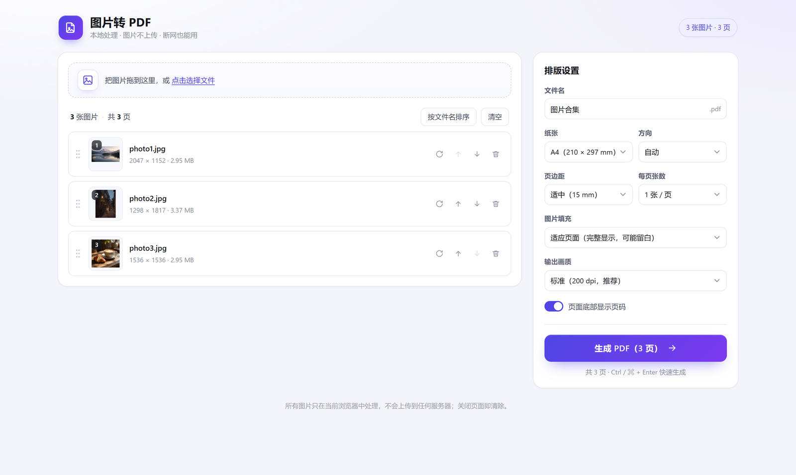
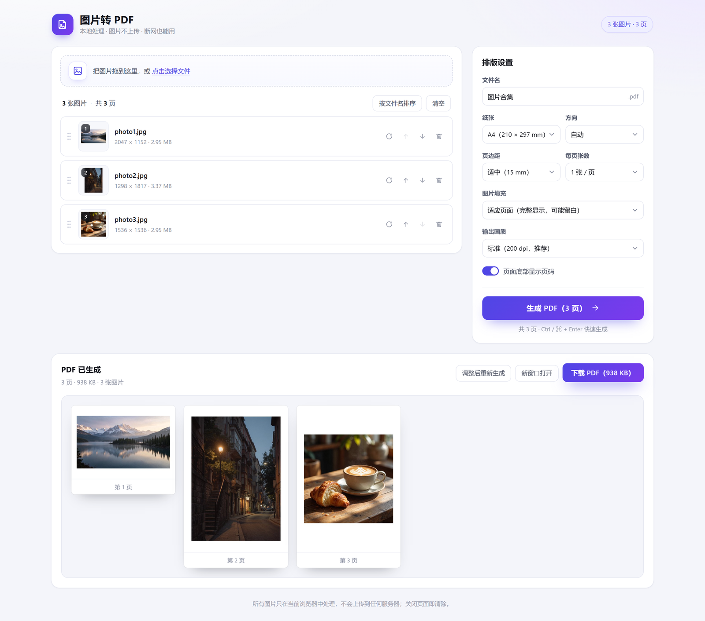

# 图片转 PDF · Image to PDF

把一批图片按顺序合成 PDF。**全程在浏览器本地处理，图片不上传、断网也能用**；项目零第三方前端依赖，双击 `index.html` 就能跑。

[在线演示](https://pppyx-hub.github.io/image-to-pdf/) · [English](README.en.md) · [命令行批量版](#命令行批量版)

[](https://github.com/pppyx-hub/image-to-pdf/actions/workflows/ci.yml)
[](https://github.com/pppyx-hub/image-to-pdf/actions/workflows/pages.yml)
[](LICENSE)



## 为什么又做一个图片转 PDF 工具

- **隐私**：合同、证件、孩子照片这类材料，不应该为了合成一个 PDF 就上传到别人的服务器。
- **离线**：出差、断网、内网环境都能用；网页版没有后端，也没有任何网络请求。
- **可控**：纸张、方向、边距、每页张数、填充方式、画质都能调，生成前能看到真实排版缩略图。
- **零依赖**：不引入 jsPDF / pdf-lib，PDF 结构由 `pdf-core.js` 自己写，代码量小、体积可控。

## 功能

**网页版**

- 导入：多选、拖拽、**拖入整个文件夹**（自动递归子目录），支持 JPG / PNG / WebP / GIF / BMP
- 排序：列表拖动、上移/下移、按文件名自然排序（`1, 2, 10` 不会乱序）
- 单张处理：旋转 90°、删除；点击缩略图可看大图（支持键盘操作，Esc 关闭）
- 纸张：A4 / A3 / Letter / 自适应（页面跟随图片比例，适合长截图与手机长图）
- 方向：自动（单页横图自动横排）/ 纵向 / 横向
- 页边距：无边框 / 8 mm / 15 mm / 25 mm
- 每页张数：1 / 2 / 4 张，自动分格
- 填充：适应页面（完整显示）/ 铺满页面（居中裁切）
- 画质：高清 300 dpi / 标准 200 dpi / 小体积 130 dpi
- 页码：页面底部居中，可开关（自适应纸张时自动禁用）
- 结果预览：按最终版式渲染缩略图（最多 12 页），显示页数与体积，可下载或新窗口打开
- 细节：设置自动记住、`Ctrl / ⌘ + Enter` 快速生成、内置示例图片、移动端适配

**命令行版（Python + Pillow）**

- 整个文件夹递归处理，按文件名自然排序或按修改时间排序
- 与网页版一致的纸张 / 边距 / 每页张数 / 填充 / 画质参数
- `--size auto` 让每页跟随图片比例，适合长图合集
- 适合放进脚本、批处理或定时任务

## 快速开始

### 网页版（无需安装）

1. 打开 [在线演示](https://pppyx-hub.github.io/image-to-pdf/)，或下载本仓库后双击 `index.html`（Windows 自带 Edge 即可）。
2. 把图片拖进虚线区域，或点击选择；也可以直接拖入一个文件夹。
3. 调整纸张、边距、每页张数等设置。
4. 点击「生成 PDF」→ 查看缩略图 → 下载。

> 本地打开不依赖任何服务；页面里没有埋点、没有 CDN、没有第三方脚本。

### 命令行批量版

```bash
pip install -r requirements.txt

# 整个文件夹合成一个 A4 PDF（按文件名自然排序）
python batch_img2pdf.py ./照片 -o 相册.pdf

# 每页 2 张、页边距 12mm、200dpi
python batch_img2pdf.py ./照片 -o 相册.pdf --margin 12 --dpi 200 --per-sheet 2

# 指定文件 + 铺满裁切 + 高画质
python batch_img2pdf.py 01.jpg 02.png 03.webp -o 合集.pdf --fit cover --quality 92

# 页面跟随图片比例（适合长截图，一本一条）
python batch_img2pdf.py ./长图 -o 长图合集.pdf --size auto
```

| 参数 | 说明 | 默认 |
| --- | --- | --- |
| `inputs` | 图片文件或文件夹，可多个 | 必填 |
| `-o, --output` | 输出路径 | `图片合集_日期.pdf` |
| `--size` | `A4` / `A3` / `Letter` / `auto` | `A4` |
| `--margin` | 页边距（毫米） | `12` |
| `--dpi` | 输出分辨率 72–400 | `200` |
| `--quality` | JPEG 质量 40–95 | `88` |
| `--fit` | `contain`（完整）/ `cover`（裁切铺满） | `contain` |
| `--per-sheet` | 每页 1 / 2 / 4 张 | `1` |
| `--sort` | `name`（自然排序）/ `mtime`（修改时间） | `name` |
| `--no-recursive` | 不递归子文件夹 | 关闭 |

## 生成结果



## 实现说明

整体流程：

```
选择 / 拖入图片
   → 读取尺寸、校正 EXIF 方向、按目标 DPI 重绘到 Canvas（透明 PNG 铺白底）
   → planPages() 计算每页纸张尺寸与每张图的 PDF 坐标
   → PDFBuilder 把 JPEG 字节写成 /DCTDecode 图像对象，拼页面与 xref
   → Blob → 页面内预览 + 下载
```

- **手写 PDF 结构**：`pdf-core.js` 生成 PDF 1.4；每张图作为 XObject 以 JPEG 原始字节写入（`/Filter /DCTDecode`），页面用 `cm` 变换矩阵定位，交叉引用表偏移自行计算。因此不需要任何 PDF 库。
- **坐标约定**：PDF 原点在页面左下角，单位 pt（1 pt = 1/72 inch）；A4 = 595.28 × 841.89 pt。
- **分页计算**：`planPages()` 统一处理纸张、横纵方向、边距、1/2/4 张分格、`contain` 缩放与 `cover` 裁切；自适应纸张以 A4 长边 841.89 pt 为基准，按第一张图比例定页面。
- **图片重绘**：浏览器解码时自动校正 EXIF 方向；透明 PNG 先铺白底，避免 PDF 里出现黑底；输出分辨率取「目标物理尺寸 × DPI」与原图尺寸的较小值，兼顾清晰度和体积。
- **设置记忆**：纸张、方向、边距、每页张数、填充、画质、页码开关与文件名保存在 `localStorage`（键名 `image-to-pdf.settings.v1`）。
- **文件夹拖入**：使用 `DataTransferItem.webkitGetAsEntry()` 递归读取目录，读不到时回退到普通文件列表。

## 项目结构

```
image-to-pdf/
├── index.html              # 页面结构
├── styles.css              # 界面样式与响应式布局
├── pdf-core.js             # 纯逻辑：PDF 构建 + 分页排版（可单独复用）
├── app.js                  # 交互：导入、排序、预览、生成
├── batch_img2pdf.py        # 命令行批处理版
├── requirements.txt        # 命令行运行依赖（Pillow）
├── requirements-dev.txt    # 测试依赖（Pillow + PyMuPDF）
├── tests/
│   ├── pdf-core.test.mjs   # 排版几何与 PDF 结构单元测试
│   └── test_cli.py         # 命令行版集成测试
├── docs/                   # README 截图
└── .github/workflows/      # CI 与 GitHub Pages 部署
```

## 测试

```bash
# 前端：语法检查 + 单元测试（Node 18+）
npm run check
npm test

# 命令行：安装测试依赖后运行
pip install -r requirements-dev.txt
python -m unittest discover -s tests -p "test_*.py" -v
```

CI 会同时在 Node 20 与 Python 3.12 上跑上述检查；`pages.yml` 在 `main` 分支更新前端文件时自动部署在线演示。

## 浏览器兼容与限制

- 开发与自动化回归基于 **Edge / Chromium**；界面使用了标准 Canvas、File、Blob API，其他现代浏览器理论可用，但未逐项回归。
- 仅支持浏览器能解码的格式；**GIF 只取第一帧**，HEIC / HEIF 需先转成 JPG。
- 自适应纸张模式会关闭页码与页边距（页面尺寸跟随图片，无法保证统一页脚位置）。
- 图片很多或单张像素极高时会占用较多内存；生成过程逐张处理并显示进度，建议单张不超过 8000 万像素。
- 命令行版会把所有页面同时放在内存中再写出，超大相册建议分批执行。
- 旋转与排序只影响版式，不会修改原图文件。

## 贡献

欢迎提 Issue 或 PR。改动前建议先跑一遍上面的测试；涉及排版的计算请补充 `tests/pdf-core.test.mjs` 里的用例，避免回归。

## License

[MIT](LICENSE) © 2026 pppyx-hub
